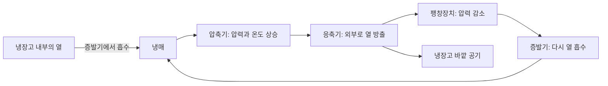

# 냉장고의 원리와 올바른 사용법

**2026학년도 2학기 오픈소스소프트웨어기초 · 5조 문서 협업 프로젝트**

냉장고는 우리 일상에서 매일 사용하는 가전제품입니다. 하지만 냉장고가 어떻게 내부를 차갑게 유지하는지, 각 부품이 어떤 역할을 하는지, 식품을 어떻게 배치하고 관리해야 하는지는 자세히 알지 못하는 경우가 많습니다. 이 프로젝트는 냉장고를 주제로 누구나 이해할 수 있는 설명서를 함께 만드는 활동입니다. 전문 지식이 없는 독자도 읽을 수 있도록 어려운 용어는 풀어서 설명하고, 그림과 생활 속 예시를 통해 내용을 전달합니다.

## 프로젝트 목표

냉장고의 역사와 종류부터 주요 부품, 냉각 원리, 온도 관리, 사용과 관리, 식품 보관까지 여섯 가지 관점으로 내용을 구성합니다. 독자는 관심 있는 문서를 먼저 읽거나, 목차 순서에 따라 냉장고의 기본 개념부터 생활 속 활용까지 살펴볼 수 있습니다.

또한 팀원 모두가 GitHub에서 문서를 작성하고 검토하는 경험을 쌓는 것을 목표로 합니다. 각자의 브랜치에서 작업하고, 변경 내용을 커밋으로 기록하며, Pull Request(PR)를 통해 서로의 문서를 검토한 뒤 `main`에 병합합니다. 완성된 결과물뿐 아니라 자료를 조사하고 의견을 나누며 문서를 개선한 과정도 기록합니다.

## 한눈에 보는 냉장고의 원리



*그림 1. 일반적인 증기 압축식 냉장고의 열 이동과 냉매 순환을 단순화한 자체 제작 개념도입니다. GitHub에서 Mermaid 그림으로 표시됩니다.*

냉장고는 냉매가 순환하면서 내부의 열을 외부로 옮기는 방식으로 작동합니다. 위 그림은 전체 흐름을 이해하기 위한 안내이며, 각 부품의 역할은 주요 부품 문서에서, 냉매의 상태 변화와 순환 과정은 냉각 원리 문서에서 자세히 설명합니다.

## 문서 목차 및 역할 분담

아래 목차에서 각 문서 제목이나 파일 링크를 클릭하면 담당 문서로 이동합니다. 각 문서는 팀원별 브랜치에서 작성하고 PR 검토를 거쳐 main에 반영합니다.

| 담당 | 주제 | 주요 내용 | 문서 파일 |
| --- | --- | --- | --- |
| 김신권 ([@sin-nnn](https://github.com/sin-nnn)) | [냉장고의 역사와 종류](docs/01-history-and-types.md) | 등장 배경, 발전 과정, 용도에 따른 종류 | [01-history-and-types.md](docs/01-history-and-types.md) |
| 정승민 ([@jnikem](https://github.com/jnikem)) | [냉장고의 주요 부품](docs/02-components.md) | 압축기, 응축기, 팽창장치, 증발기의 역할 | [02-components.md](docs/02-components.md) |
| 최예윤 ([@yunn1215](https://github.com/yunn1215)) | [냉장고의 냉각 원리](docs/03-cooling-principle.md) | 열 이동, 냉매의 상태 변화, 냉각 사이클 | [03-cooling-principle.md](docs/03-cooling-principle.md) |
| 황인성 ([@spseong](https://github.com/spseong)) | [냉장실·냉동실과 온도 관리](docs/04-temperature-management.md) | 공간별 역할, 냉기 순환, 온도 변화 요인 | [04-temperature-management.md](docs/04-temperature-management.md) |
| 이견희 ([@GyunHeee](https://github.com/GyunHeee)) | [냉장고 사용과 관리](docs/05-use-and-care.md) | 설치 환경, 청소, 문 패킹 관리, 에너지 절약 | [05-use-and-care.md](docs/05-use-and-care.md) |
| 정형선 ([@hseon20](https://github.com/hseon20)) | [냉장고 속 식품 보관](docs/06-food-storage.md) | 식품 분류, 보관 용기, 배치, 교차오염 예방 | [06-food-storage.md](docs/06-food-storage.md) |

주요 부품 문서는 부품 각각의 기능을 설명하고, 냉각 원리 문서는 부품들이 연결되어 작동하는 과정을 설명합니다. 온도 관리 문서는 냉장고 내부 환경에, 식품 보관 문서는 식품을 다루는 방법에 집중하여 내용의 중복을 줄입니다.

### 5번 문서 읽기 안내

[냉장고 사용과 관리](docs/05-use-and-care.md)는 설치, 내부 청소, 문 패킹 관리, 에너지 절약, 관리 체크리스트, 참고자료 순서로 구성했습니다. 설치 환경과 청소 순서를 보여주는 그림 2개, 상황별 확인표, 자주 묻는 질문을 함께 제공합니다. 문서 상단의 링크를 통해 이 README로 돌아올 수 있습니다.

## 문서 작성 기준

- 각 Markdown 문서는 본문 1,000자 이상으로 작성하고, 내용을 설명하는 그림을 최소 1개 포함합니다.
- 문서는 소개, 핵심 개념, 구체적인 예시, 그림과 해설, 정리, 참고자료 순서로 구성하는 것을 기본으로 합니다.
- 직접 제작한 그림에는 자체 제작임을 표시하고, 외부 그림에는 출처와 이용 조건을 확인하여 표시합니다.
- 자료를 인용하거나 요약한 경우 문서 끝에 자료명, 제공 기관, 링크를 기록합니다.
- AI로 만든 초안은 담당자가 내용을 이해하고 검토한 뒤 사용합니다. 역사적 사실, 수치, 식품별 보관 온도와 기간은 근거 자료를 확인합니다.
- 제품별 설치 조건과 관리 방법은 제조사 설명서를, 식품 안전 관련 내용은 식품의약품안전처 등 공신력 있는 기관의 안내를 우선 참고합니다.

## 브랜치 및 협업 규칙

`main`은 검토가 완료된 문서를 모으는 기본 브랜치입니다. 팀원은 `main`에 직접 커밋하지 않고, 자신의 작업 브랜치에서 문서를 작성한 뒤 PR을 생성합니다.

| 용도 | 브랜치 이름 |
| --- | --- |
| 전체 README 관리 | `docs/readme` |
| 역사와 종류 | `docs/아이디-history-and-types` |
| 주요 부품 | `docs/아이디-components` |
| 냉각 원리 | `docs/아이디-cooling-principle` |
| 온도 관리 | `docs/아이디-temperature-management` |
| 사용과 관리 | `docs/아이디-use-and-care` |
| 식품 보관 | `docs/아이디-food-storage` |

위 표의 `아이디`는 본인의 영문 GitHub ID로 바꿉니다. 각자는 담당 문서와 관련 이미지를 관리하고, 다른 사람의 담당 파일을 수정해야 할 때는 먼저 협의합니다. 전체 소개, 목차, 팀원 정보의 변경은 `docs/readme` 브랜치에서 진행합니다.

1. 최신 `main`을 기준으로 작업 브랜치를 만들거나 기존 브랜치에 최신 내용을 반영합니다.
2. 목차 작성, 본문 보완, 그림 추가, 출처 확인 등 의미 있는 변경 단위로 커밋합니다.
3. 변경 내용과 확인한 항목을 적어 PR을 생성합니다.
4. 다른 팀원 최소 1명이 내용의 정확성, 분량, 그림, 출처, 링크를 검토합니다.
5. 피드백을 반영한 뒤 `Create a merge commit` 방식으로 병합하여 개별 커밋 기록을 보존합니다.

커밋 메시지와 PR 제목은 다음 예시처럼 변경 내용을 구체적으로 적습니다.

```text
docs: 전체 README 소개와 협업 규칙 작성
docs: 냉각 원리 본문과 순환도 추가
fix: 문서 이미지 경로 수정

PR 제목 예시: [README] 프로젝트 소개와 문서 구성 작성
```

## 발표 및 제출 계획

발표에서는 냉장고 문서의 핵심 내용, 여섯 문서를 나눈 기준, 브랜치와 PR을 활용한 협업 과정, 작업하며 배운 점을 소개합니다. 팀당 발표 시간은 5분이며, 팀 발표와 LMS 제출 마감은 **2026년 10월 19일 월요일**, 제출 시각은 **낮 12시**입니다. LMS에는 저장소 URL, 팀원별 이름과 GitHub ID, 발표자료를 제출합니다.

- 저장소: [yunn1215/oss-team5](https://github.com/yunn1215/oss-team5)
- 팀원 정보: [문서 목차 및 역할 분담](#문서-목차-및-역할-분담) 표 참고 / 발표자료: 추후 추가 예정