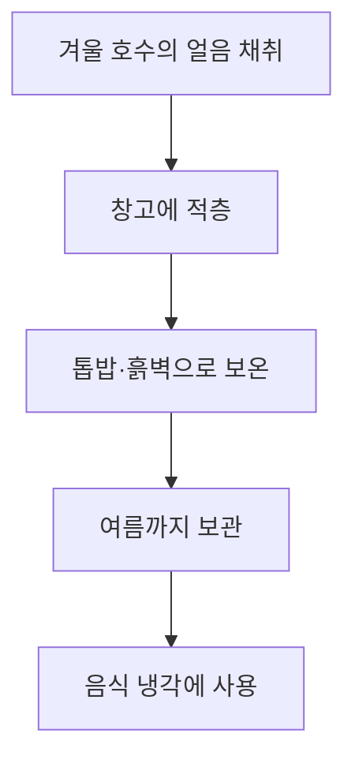

# 냉장고의 역사와 종류

## 소개

냉장고는 음식을 차갑게 보관해 부패를 늦추는 가전제품입니다. 이 문서에서는 냉장고가 어떤 배경에서 등장했고, 어떤 과정을 거쳐 발전했는지 정리합니다. 또한 가정용과 업소용처럼 사용 목적에 따라 나뉘는 종류도 함께 살펴봅니다.

## 목차

1. 등장 배경
2. 발전 과정
3. 가정용 냉장고
4. 업소용 냉장고
5. 정리

## 1. 등장 배경

### 음식이 상하는 이유

냉장고가 등장하기 전에도 사람들은 음식을 오래 보관하는 방법을 찾아왔습니다. 음식은 시간이 지나면 미생물이 번식하고 효소 작용이 일어나 상하기 쉽기 때문입니다. 그래서 오랜 세월 동안 음식을 식히고, 말리고, 소금에 절이고, 훈제하고, 발효시키는 방법이 발달했습니다. 이런 방법들은 모두 음식이 상하는 속도를 늦추는 데 목적이 있었습니다.

### 증발 열을 이용한 옛 방법

그중에서도 온도를 낮추는 방법은 특히 중요했습니다. 온도가 낮아지면 미생물의 활동이 느려지기 때문입니다. 고대 이집트와 인도 등 더운 지역에서는 물이 증발할 때 주변 열을 빼앗아 가는 원리를 이용해, 물그릇이나 젖은 천으로 항아리를 감싸 온도를 조금 낮추는 방식이 쓰였다고 알려져 있습니다. 다만 이 방법은 습도가 높은 날에는 효과가 떨어졌고, 보관할 수 있는 기간도 짧았습니다.

### 얼음 저장고의 한계

더 효과적인 방법은 얼음을 이용하는 것이었습니다. 추운 지역에서는 겨울에 호수나 강의 얼음을 잘라 창고에 쌓아 두고, 두꺼운 흙벽이나 톱밥, 짚 등으로 감싸 여름까지 녹지 않도록 보관했습니다. 이것이 얼음 저장고(icehouse)입니다. 얼음 저장고는 상당한 노동과 자원이 필요했습니다. 얼음을 채취하고 운반하며, 보온 자재를 준비하는 일이 모두 필요했기 때문입니다. 그래서 얼음을 쉽게 구할 수 있는 곳에서만 쓸 수 있었습니다. 얼음은 귀했습니다.

