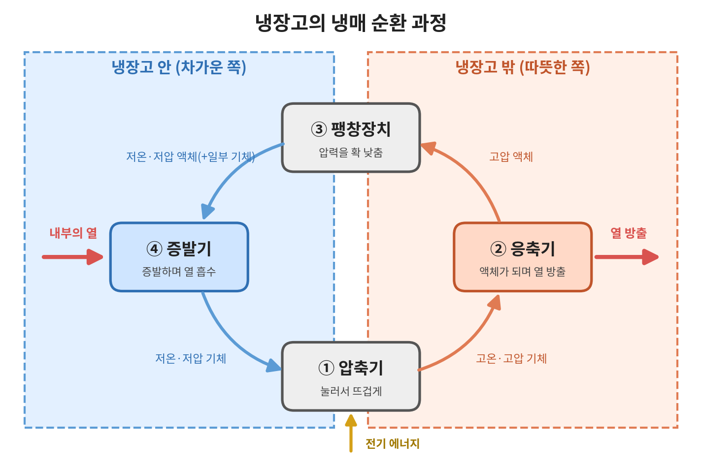

# ❄️ 냉장고의 냉각 원리
> 냉장고는 차가운 기운을 만드는 기계가 아니라, 안쪽의 열을 바깥으로 옮기는 기계입니다.

## 1. 소개
냉장고 문을 열면 차가운 공기가 느껴지기 때문에, 많은 사람들은 냉장고가 냉기를 "만들어 낸다"고 생각합니다. 하지만 실제로 냉장고는 차가운 기운을 새로 만드는 것이 아니라, 냉장고 안에 있는 열을 바깥으로 "옮기는" 장치입니다. 안쪽의 열이 계속 빠져나가기 때문에 내부가 차갑게 유지되는 것입니다.

그렇다면 냉장고는 어떻게 열을 붙잡아 밖으로 내보낼 수 있을까요? 그 비밀은 냉장고 속을 끊임없이 돌고 있는 **냉매**라는 물질과, 냉매가 액체와 기체로 모습을 바꾸는 **상태 변화**에 있습니다.

이 문서에서는 열이 이동하는 기본 원리부터 냉매가 냉장고 안팎을 순환하며 열을 옮기는 과정까지 차례대로 설명합니다. 압축기, 응축기 등 각 부품의 구조와 기능은 [냉장고의 주요 부품](02-components.md) 문서에서 자세히 다루며, 이 문서에서는 부품들이 연결되어 **실제로 냉각이 일어나는 과정**에 집중합니다.

## 2. 핵심 개념
냉장고의 작동 원리를 이해하려면 먼저 열이 어떻게 움직이는지, 그리고 물질의 상태가 바뀔 때 열이 어떻게 오가는지 알아야 합니다. 여기서는 냉장고를 이해하는 데 필요한 세 가지 기본 개념을 소개합니다.

### 2-1. 열은 따뜻한 곳에서 차가운 곳으로 이동한다
뜨거운 커피를 책상 위에 두면 시간이 지나면서 점점 식습니다. 커피가 가진 열이 상대적으로 차가운 주변 공기로 빠져나가기 때문입니다. 이처럼 열은 자연스럽게 온도가 높은 곳에서 낮은 곳으로만 이동하며, 그냥 두었을 때 차가운 곳에서 따뜻한 곳으로 저절로 이동하는 일은 일어나지 않습니다.

그런데 냉장고는 이 자연스러운 흐름을 거스릅니다. 차가운 냉장고 안에서 열을 꺼내 더 따뜻한 바깥 공기로 내보내야 하기 때문입니다. 물을 낮은 곳에서 높은 곳으로 끌어올리려면 펌프가 필요하듯, 열을 반대 방향으로 옮기려면 에너지가 필요합니다. 냉장고가 항상 전기를 사용하는 이유가 바로 여기에 있습니다.

### 2-2. 액체가 증발할 때 주변의 열을 빼앗는다
손에 알코올 손소독제를 바르면 금방 시원해지는 것을 느낄 수 있습니다. 알코올이 액체에서 기체로 증발하면서 손의 열을 가져가기 때문입니다. 더운 날 땀이 마를 때 몸이 시원해지는 것도 같은 원리입니다.

액체가 기체로 바뀌려면 에너지가 필요한데, 이때 액체는 주변에서 열을 흡수합니다. 이렇게 증발할 때 흡수하는 열을 **기화열**이라고 합니다. 반대로 기체가 다시 액체로 바뀔 때는 흡수했던 열을 주변으로 내보냅니다. 냉장고는 바로 이 성질을 이용해, 안에서는 액체를 증발시켜 열을 빼앗고 밖에서는 기체를 액체로 되돌리며 열을 버립니다.

### 2-3. 압력에 따라 끓는점이 달라진다
물은 보통 100℃에서 끓는다고 알고 있지만, 이는 우리가 생활하는 지표면의 기압에서의 이야기입니다. 공기가 희박해 압력이 낮은 높은 산 위에서는 물이 100℃보다 낮은 온도에서 끓습니다. 그래서 높은 산에서 밥을 지으면 쌀이 설익기 쉽습니다. 반대로 압력솥은 내부 압력을 높여 물이 100℃보다 높은 온도에서 끓게 만들기 때문에 음식이 빨리 익습니다.

즉, **압력을 낮추면 물질은 더 낮은 온도에서도 쉽게 증발하고, 압력을 높이면 더 높은 온도에서도 액체 상태가 됩니다.** 냉장고는 압력을 조절해 냉장고 안에서는 냉매가 낮은 온도에서도 증발하게 만들고, 바깥에서는 냉매가 다시 액체로 돌아가게 만듭니다. 이 과정은 4장에서 자세히 살펴봅니다.

## 3. 냉매란?
**냉매**는 냉장고 안을 끊임없이 순환하며 열을 실어 나르는 물질입니다. 냉매의 가장 중요한 성질은 아주 낮은 온도에서도 쉽게 끓는다는 점입니다. 물은 100℃가 되어야 끓지만, 냉장고에 쓰이는 냉매는 영하의 온도에서도 끓어 기체가 될 수 있습니다. 그래서 차가운 냉장고 안에서도 증발하며 주변의 열을 흡수할 수 있습니다.

냉매의 역할은 택배 기사에 비유할 수 있습니다. 택배 기사가 물건을 받아 다른 곳에 내려놓듯이, 냉매는 냉장고 안에서 증발하며 열을 "받아" 오고, 냉장고 바깥에서 다시 액체가 되며 그 열을 "내려놓습니다". 냉매 자체는 소모되지 않고 같은 길을 계속 돌며 이 일을 반복합니다. 따라서 고장으로 냉매가 새어 나가지 않는 한, 냉매를 따로 보충할 필요가 없습니다.

냉매의 종류도 시대에 따라 바뀌어 왔습니다. 과거에는 프레온 가스라고 불리는 염화불화탄소(CFC) 계열 냉매가 널리 쓰였지만, 오존층을 파괴한다는 사실이 밝혀지면서 국제 협약(몬트리올 의정서)에 따라 사용이 금지되었습니다. 이후 오존층에 영향을 주지 않는 냉매로 바뀌었고, 최근 가정용 냉장고에서는 지구 온난화에 미치는 영향까지 적은 이소부탄(R-600a) 같은 냉매가 많이 사용됩니다.
## 4. 냉매 순환 과정

<!-- 그림: 냉매 순환도 (직접 제작한 PNG) -->

*그림 1. 압축 → 응축 → 팽창 → 증발로 이어지는 냉매 순환 과정 (자체 제작)*

냉장고 속 냉매는 **압축 → 응축 → 팽창 → 증발**의 네 단계를 하나의 고리처럼 반복합니다. 각 단계에서 냉매는 기체와 액체 사이를 오가며 압력과 온도가 바뀌고, 그 과정에서 냉장고 안의 열을 흡수했다가 바깥으로 내보냅니다. 앞에서 살펴본 기화열과 압력에 따른 끓는점 변화가 실제로 어떻게 쓰이는지 단계별로 살펴보겠습니다.

### 4-1. 압축: 기체를 꽉 눌러 뜨겁게 만든다
냉장고 안에서 열을 흡수하고 나온 냉매는 온도와 압력이 모두 낮은 기체 상태입니다. 이 기체는 먼저 **압축기**로 들어가 강하게 눌립니다. 자전거 바퀴에 바람을 넣을 때 펌프가 뜨거워지는 것처럼, 기체는 압축되면 온도가 올라갑니다. 압축기를 지난 냉매는 바깥 공기보다 훨씬 뜨거운 고온·고압의 기체가 됩니다. 냉매를 바깥 공기보다 뜨겁게 만들어야 다음 단계에서 열을 밖으로 내보낼 수 있기 때문입니다. 냉장고가 사용하는 전기의 대부분은 바로 이 압축 과정에 쓰입니다.

### 4-2. 응축: 바깥으로 열을 내보낸다
뜨거워진 냉매 기체는 냉장고 뒤쪽이나 옆면에 있는 **응축기**로 이동합니다. 2-1에서 살펴본 것처럼 열은 따뜻한 곳에서 차가운 곳으로 이동하므로, 바깥 공기보다 뜨거운 냉매는 자연스럽게 주변 공기로 열을 내보냅니다. 열을 잃은 냉매는 압력이 높은 상태 그대로 점점 식으며 기체에서 액체로 바뀝니다. 이때 냉장고 안에서 흡수했던 열과 압축 과정에서 더해진 열이 함께 바깥으로 버려집니다.

### 4-3. 팽창: 압력을 확 낮춘다
응축기를 지나 액체가 된 냉매는 아직 압력이 높고 온도도 미지근한 상태입니다. 이 냉매는 이제 **팽창장치**를 지나게 됩니다. 가정용 냉장고에서는 보통 머리카락처럼 가는 관인 모세관이 이 역할을 합니다. 좁은 통로를 억지로 빠져나오면서 냉매의 압력은 갑자기 크게 떨어집니다.

2-3에서 살펴본 것처럼 압력이 낮아지면 끓는점도 낮아집니다. 그래서 압력이 떨어진 냉매는 일부가 곧바로 증발하기 시작하고, 이 과정에서 스스로의 열을 빼앗겨 온도가 영하 수십 도까지 내려갑니다. 스프레이를 오래 뿌리면 캔이 차가워지는 것도 비슷한 원리입니다.
### 4-4. 증발: 냉장고 안의 열을 빼앗는다
아주 차가워진 냉매는 냉장고 안쪽에 있는 **증발기**로 들어갑니다. 증발기 주변의 공기는 냉매보다 따뜻하기 때문에, 냉매는 이 공기에서 열을 흡수하며 남은 액체까지 모두 기체로 바뀝니다. 2-2에서 설명한 기화열이 바로 여기서 쓰이는 것입니다. 열을 빼앗긴 공기는 차가워지고, 이 차가운 공기가 냉장실과 냉동실 곳곳으로 퍼져 음식을 시원하게 유지합니다. 냉기가 각 공간으로 퍼지는 방식은 [냉장실·냉동실과 온도 관리](04-temperature-management.md) 문서에서 자세히 다룹니다.

열을 흡수하고 다시 저온·저압의 기체가 된 냉매는 압축기로 돌아가고, 처음의 압축 단계부터 같은 과정을 반복합니다.

### 4-5. 한눈에 보는 냉매 순환

| 단계 | 장치 | 냉매 상태 변화 | 압력·온도 | 열의 이동 |
| --- | --- | --- | --- | --- |
| 압축 | 압축기 | 기체 → 기체 | 저압·저온 → 고압·고온 | 전기 에너지가 더해짐 |
| 응축 | 응축기 | 기체 → 액체 | 고압 유지, 온도 하강 | 냉장고 **밖으로** 열 방출 |
| 팽창 | 팽창장치(모세관) | 액체 → 액체+일부 기체 | 고압 → 저압, 온도 급강하 | 큰 열 이동 없음 |
| 증발 | 증발기 | 액체 → 기체 | 저압·저온 유지 | 냉장고 **안에서** 열 흡수 |

이처럼 냉매는 냉장고 안에서는 증발하며 열을 흡수하고, 바깥에서는 응축하며 열을 내보냅니다. 이 순환이 계속 반복되기 때문에 냉장고 안의 열이 꾸준히 밖으로 옮겨지고, 내부는 낮은 온도로 유지됩니다.

## 5. 생활 속에서 확인하기
<!-- 목표: 약 250자
- 냉장고 뒤나 옆이 따뜻한 이유 → 안에서 빼낸 열이 버려지는 곳
- 에어컨도 같은 원리 (실외기가 뜨거운 바람을 내보내는 이유)
- 냉장고 문을 열어둬도 방이 시원해지지 않는 이유 (오히려 더워짐) -->

## 6. 정리
<!-- 목표: 약 150자
- 냉장고는 냉매의 상태 변화로 열을 안에서 밖으로 옮긴다
- 핵심은 증발할 때 열 흡수, 응축할 때 열 방출
- 다음 문서 [냉장실·냉동실과 온도 관리](04-temperature-management.md)로 연결 -->

## 📚 참고 자료
<!-- 자료명, 제공 기관, 링크 형식으로 작성
예: 냉동 사이클의 원리, 한국에너지공단, https://... -->