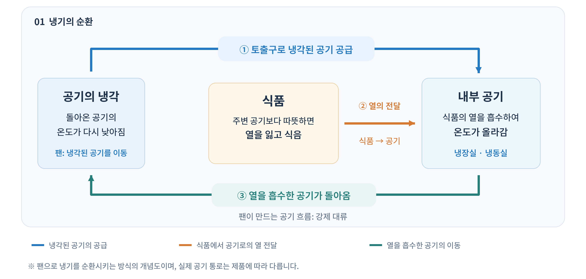
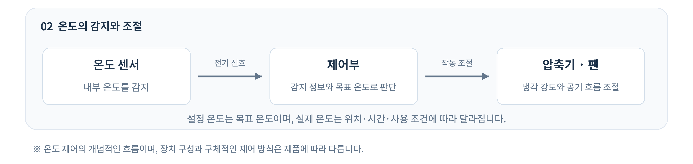

# 냉장실, 냉동실과 온도 관리

## 1. 소개

 냉장실과 냉동실은 서로 다른 온도를 유지하며 식품을 보관하는 공간입니다. 냉장고 내부의 온도를 이해하려면 두 공간의 역할뿐 아니라 냉기가 내부에 전달되고 순환하는 과정, 위치에 따른 온도 차이, 온도를 감지하고 조절하는 방식도 살펴봐야 합니다.

 이 문서에서는 냉장실과 냉동실의 차이를 알아보고, 내부의 공기 흐름과 온도 조절을 중심으로 설명합니다. 냉매의 상태 변화와 냉각 과정의 상세 원리는 앞의 냉각 원리 문서에서, 설치와 청소 등 관리 요령은 사용과 관리 문서에서 다룹니다.

## 2. 냉장실과 냉동실의 역할

### 2.1 냉장실의 역할

 냉장실은 식품을 낮은 온도로 유지하여 세균의 증식을 늦추는 공간입니다. 미국 식품의약국(FDA)은 식품 안전을 위해 냉장실 온도를 **4℃** 이하로 유지하도록 권고합니다. 다만 냉장 상태에서도 자랄 수 있는 세균이 있으므로, 냉장 보관만으로 식품의 안전이 무조건 보장되는 것은 아닙니다.

### 2.2 냉동실의 역할

 냉동실은 식품을 얼린 상태로 유지하여 냉장보다 오래 보관할 수 있도록 하는 공간입니다. FDA는 냉동실 온도를 **−18℃**로 유지하도록 안내합니다. 냉동은 세균의 증식을 억제하지만 대부분의 세균을 죽이지는 않습니다. 또한 보관 기간이 길어지면 맛과 식감 등 품질이 떨어질 수 있습니다.

### 2.3 두 공간의 차이

| 구분 | 냉장실 | 냉동실 |
| --- | --- | --- |
| 온도 수준 | 식품을 차갑게 유지하는 낮은 온도 | 식품을 얼린 상태로 유지하는 영하의 온도 |
| 보관 상태 | 식품을 일반적으로 얼리지 않고 보관 | 식품을 얼려 보관 |
| 주된 역할 | 낮은 온도에서 식품 보관 | 냉장보다 장기간 식품 보관 |

 두 공간은 유지하는 온도와 식품의 상태가 다르므로, 제품에 표시된 보관 조건에 맞게 구분하여 사용해야 합니다.

## 3. 냉기의 순환과 공간별 온도 차이

### 3.1 냉기가 내부로 전달되는 과정

**① 냉각된 공기의 공급**

 팬으로 냉기를 순환시키는 방식의 냉장고에서는 냉각된 공기가 내부 통로를 지나 냉장실과 냉동실에 공급됩니다.

**② 식품의 열 흡수** 

 이때 식품의 온도가 주변 공기보다 높으면 식품의 열이 공기로 전달되어 식품은 식고 공기는 따뜻해집니다.

**③ 공기의 귀환과 재냉각**

 열을 흡수한 공기는 다시 냉각되는 쪽으로 돌아가 온도가 낮아진 뒤 내부로 공급됩니다. 이러한 순환이 반복되면서 식품과 내부 공간의 온도가 낮게 유지됩니다. 즉, 내부 공기는 순환하면서 식품의 열을 운반하는 역할을 합니다. 구체적인 공기 통로와 냉각 구조는 제품에 따라 다릅니다.

### 3.2 팬과 통풍구의 역할

 팬은 회전하는 날개로 공기를 밀어 내부에 흐름을 만드는 장치입니다. 공기가 온도에 따른 밀도 차이로 움직이는 자연 대류와 달리, 팬을 이용해 공기를 움직이는 방식을 강제 대류라고 합니다. 팬은 냉기를 직접 만드는 대신 냉각된 공기를 이동시켜 내부의 여러 위치에 전달합니다.

 통풍구는 공기가 드나드는 통로이며, 냉각된 공기를 내보내는 구멍을 토출구라고 합니다. 토출구로 나온 공기가 내부를 지나 다시 돌아갈 수 있어야 순환이 이어집니다. 따라서 팬이 작동하더라도 공기 통로가 막히면 일부 위치에 냉기가 충분히 도달하지 못할 수 있습니다. 식품 배치와 통풍구 관리에 관한 자세한 내용은 [냉장고 사용과 관리](05-use-and-care.md) 문서를 참고하세요.

*그림 1. 냉기의 순환과정 (자체 제작, AI 도구 활용)*

### 3.3 위치에 따른 온도 차이

 냉장고 내부의 온도는 같은 시각에도 위치에 따라 다를 수 있습니다. 냉각된 공기는 내부를 이동하면서 식품과 주변의 열을 흡수하므로, 토출구에서 공급될 때와 내부를 지나 돌아갈 때의 온도가 달라집니다. 또한 선반과 보관 용기는 공기의 이동 경로에 영향을 주어, 냉기가 잘 전달되는 곳과 상대적으로 전달이 약한 곳을 만듭니다.

 토출구 가까이에서는 차가운 공기가 직접 닿아 주변보다 강하게 냉각될 수 있습니다. 따라서 냉장실의 설정 온도가 영상이더라도, 토출구 부근의 식품은 조건에 따라 얼 수 있습니다. 반대로 공기 흐름이 약한 위치에서는 열을 흡수해 따뜻해진 공기가 충분히 빠져나가지 못하고, 냉각된 공기의 공급도 제한되어 온도가 상대적으로 높아질 수 있습니다.
 
| 위치·조건 | 온도 차이가 생기는 이유 |
| --- | --- |
| 토출구 부근 | 차가운 공기가 직접 공급되어 국소적으로 강하게 냉각될 수 있음 |
| 공기 흐름이 약한 곳 | 열을 흡수한 공기의 이동과 냉각된 공기의 공급이 원활하지 않을 수 있음 |
| 문 쪽 수납 공간 | 내부 선반과 냉기가 전달되는 조건이 다르고, 문을 열 때 외부 공기의 영향을 받음 |

 팬을 이용한 순환은 위치별 온도 차이를 줄이지만 완전히 없애지는 못합니다. 실제 온도 분포는 제품의 구조와 사용 조건에 따라 달라지므로, 특정 선반이 항상 가장 차갑다고 단정할 수는 없습니다.

## 4. 온도를 감지하고 조절하는 방법

### 4.1 온도 센서와 제어부의 역할

 온도 센서는 냉장고 내부의 온도를 감지하여 그 정보를 전기 신호로 제어부에 전달하는 장치입니다. 제어부는 이 정보와 사용자가 설정한 목표 온도를 바탕으로 냉각 장치의 작동을 조절합니다. 즉, 센서는 온도를 측정하고, 제어부는 냉각이 얼마나 필요한지 판단하는 역할을 합니다.

 내부 온도가 올라가 냉각이 필요해지면 제어부는 압축기와 팬 등의 작동을 조절하여 내부의 열을 제거하도록 합니다. 충분히 냉각되면 냉각 강도를 줄이거나 작동을 멈추도록 제어할 수 있습니다. 제품에 따라 장치를 켜고 끄는 방식뿐 아니라 압축기와 팬의 운전 속도를 바꾸는 방식도 사용합니다. 이처럼 온도를 감지하고 그 결과에 따라 작동을 조절하는 과정이 반복되면서 내부 온도가 목표 온도 부근으로 유지됩니다.

*그림 2. 온도를 감지하고 조절하는 과정 (자체 제작, AI 도구 활용)*

### 4.2 설정 온도와 실제 온도의 차이

**설정 온도는 목표값**

 설정 온도는 냉장고가 유지하려는 목표 온도입니다. LG전자 안내에 따르면 표시창의 설정 온도는 실제 내부 온도를 그대로 보여주는 값이 아니며, 식품의 양이나 사용 환경에 따라 실제 온도와 차이가 생길 수 있습니다. 예를 들어 표시창에 3℃가 나타나더라도, 내부의 모든 위치가 현재 정확히 3℃라는 뜻은 아닙니다.

**설정값이 같아도 변하는 실제 온도**

 내부 온도는 위치에 따라서도 다르지만, 같은 위치에서도 시간이 지나면서 변할 수 있습니다. 문을 열면 외부의 따뜻한 공기가 들어오고, 내부보다 따뜻한 식품을 넣으면 그 식품의 열이 주변으로 전달됩니다. 따라서 사용자가 설정값을 바꾸지 않아도 실제 내부 온도는 일시적으로 올라갈 수 있습니다.

**목표 온도 부근으로 회복되는 과정**

 문을 닫은 뒤에는 추가로 들어온 열을 제거하는 냉각이 이루어집니다. 온도 변화에 따라 냉각 장치의 작동이 조절되고, 내부 온도는 목표 온도 부근으로 돌아갑니다. 다만 냉각에는 시간이 필요하므로, 문을 닫거나 설정 온도를 낮췄다고 해서 내부 온도가 즉시 목표값으로 바뀌지는 않습니다. 회복에 걸리는 시간도 식품의 양과 온도, 주변 환경 등에 따라 달라집니다.

 이처럼 온도 유지는 내부를 하나의 값에 고정하는 것이 아니라, 열이 들어오거나 내부 조건이 달라질 때 냉각을 조절하는 과정입니다. 따라서 설정 온도는 제어의 기준으로, 실제 온도는 위치와 시점에 따라 달라지는 값으로 구분해야 합니다.

## 5. 정리

| 항목 | 핵심 내용 |
| --- | --- |
| 냉장실 | 식품을 낮은 온도로 보관하여 세균의 증식을 늦춤 |
| 냉동실 | 식품을 얼린 상태로 유지하여 장기간 보관 |
| 냉기 순환 | 공기가 식품의 열을 흡수하고 다시 냉각되는 과정을 반복 |
| 팬과 통풍구 | 공기를 이동시키고 공급·귀환 통로를 통해 순환이 이어지도록 함 |
| 위치별 온도 차이 | 토출구와의 거리, 공기 흐름, 문 쪽의 외부 공기 노출 등에 따라 온도가 달라짐 |
| 온도 센서와 제어부 | 내부 온도를 감지하고 목표 온도를 바탕으로 냉각 장치의 작동을 조절 |
| 설정 온도 | 냉장고가 유지하려는 목표값으로, 현재 내부 온도와 구분됨 |
| 실제 온도의 변화 | 같은 위치에서도 문 열림과 식품의 열 등으로 변하며, 냉각을 통해 목표 온도 부근으로 회복 |

## 6. 참고자료

| 자료명 | 제공 기관 | 활용 부분 | 참고한 내용 |
| --- | --- | --- | --- |
| [Are You Storing Food Safely?](https://www.fda.gov/consumers/consumer-updates/are-you-storing-food-safely) | 미국 식품의약국(FDA) | 2.1 냉장실의 역할, 2.2 냉동실의 역할 | 냉장·냉동 권장 온도와 식품 보관 시 주의점 |
| [작동 시 이상한 소음(드르륵, 웅, 웽, 다다닥)이 나요](https://www.lge.co.kr/support/solutions-20152438298346) | LG전자 | 3.2 팬과 통풍구의 역할 | 내부 냉기 순환에 사용되는 팬의 역할 |
| [냉기가 약하고 시원하지 않아요](https://www.samsungsvc.co.kr/solution/35637) | 삼성전자서비스 | 3.2 팬과 통풍구의 역할, 4.2 설정 온도와 실제 온도의 차이 | 냉기 통로가 막힐 때의 영향, 문 열림에 따른 외부 공기 유입, 온도 변경 후 냉각에 필요한 시간 |
| [냉장실, 냉동실 온도는 어떻게 조절하나요?](https://www.lge.co.kr/support/solutions-20151274172251) | LG전자 | 4.2 설정 온도와 실제 온도의 차이 | 표시창의 설정 온도와 실제 내부 온도의 구분 |
| [공개특허 「냉장고」, KR20210136308A](https://patents.google.com/patent/KR20210136308A/ko) | LG전자 | 4.1 온도 센서와 제어부의 역할 | 도 4 관련 설명의 온도 감지 신호 전달과 압축기·팬 제어 |
| [냉장실에 보관 중인 음식물이 얼어요](https://gscs.lge.com/gscs/collpack/contents/readChatbotContents.do?contentsId=20151807754498&corporation=LGEKR) | LG전자 | 3.3 위치에 따른 온도 차이 | 냉기 토출구 부근에서 식품이 얼 수 있는 현상 |
---
