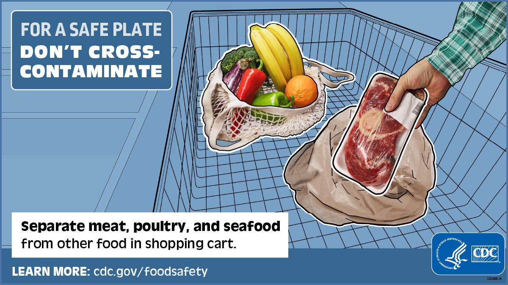
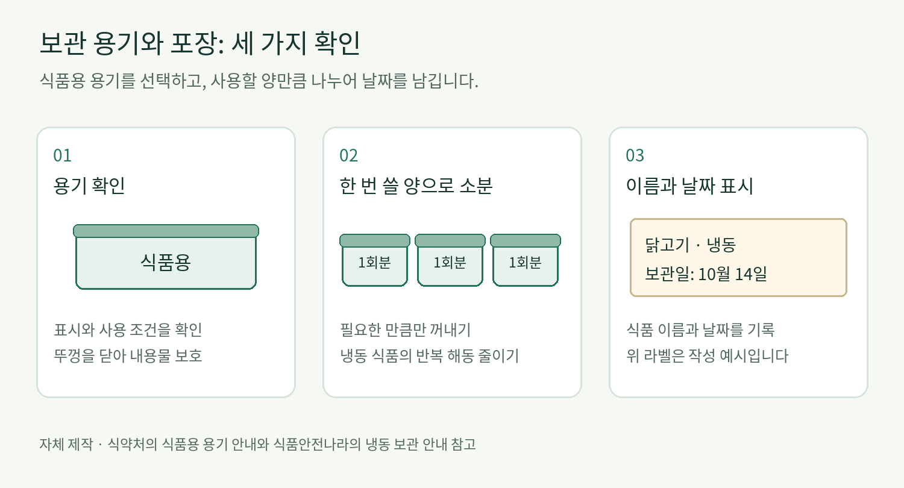

# 🥦 냉장고 속 식품 보관

> 식품을 종류별로 구분하고, 알맞은 용기와 위치에 보관하며, 장보기부터 조리까지 교차오염을 줄이는 방법을 알아봅니다.

## 1. 들어가며

### 1-1. 냉장고에 넣는 것만으로 충분하지 않은 이유

냉장과 냉동은 낮은 온도로 미생물의 증식을 늦추는 방법이지, 식품에 이미 존재하는 모든 미생물을 없애는 방법은 아닙니다. 예를 들어 생닭 포장을 샐러드 위에 올려 두면 포장의 작은 틈에서 나온 육즙이 샐러드 용기에 묻을 수 있고, 큰 냄비에 담긴 국을 식탁 위에 오래 두었다가 냉장하면 가운데까지 식는 데 시간이 걸립니다. 냉장고에 넣었다는 사실만으로 이 문제가 사라지지는 않습니다.[\[1\]](#ref-1)[\[2\]](#ref-2)

또한 냄새와 겉모습이 멀쩡해도 유해 미생물의 존재를 눈으로 판단할 수 없습니다. 냉장고에서 언제부터 있었는지 모르는 반찬을 조금 맛보아 확인하거나, 상온에 오래 둔 우유를 냄새만 맡고 다시 넣는 행동은 안전한 판단 방법이 아닙니다. 보관 시간과 온도, 포장 상태를 기준으로 판단해야 합니다.[\[2\]](#ref-2)

안전한 식품 보관은 **온도 유지**, **식품 분리**, **밀봉과 누출 방지**, **표시 확인**이라는 네 가지 원칙으로 정리할 수 있습니다. 냉동만두는 장을 본 뒤 바로 냉동실에 넣고, 생닭은 새지 않는 용기에 담아 샐러드와 떨어뜨리며, 남은 찌개는 얕은 용기에 나누고, 개봉한 우유에는 개봉일을 적는 식입니다. 이 원칙은 냉장고 안뿐 아니라 장보기, 운반, 손질, 해동 과정에도 이어집니다.[\[1\]](#ref-1)[\[3\]](#ref-3)

### 1-2. 이 문서에서 확인할 내용

이 문서는 ‘장을 본 식품을 어떤 순서로 넣을까?’, ‘남은 국은 냄비째 넣어도 될까?’, ‘생고기 포장에서 육즙이 샜다면 어디까지 닦아야 할까?’처럼 가정에서 실제로 생기는 질문을 중심으로 보관 방법을 설명합니다. 식품을 성격에 따라 나누고, 용기와 포장을 선택한 뒤, 냉장실과 냉동실에 배치하는 순서로 살펴봅니다. 이어서 교차오염 경로와 예방법을 알아보고, 마지막에는 장보기·남은 음식·해동·배달 음식과 같은 상황에 앞의 원칙을 적용합니다.

같은 ‘우유’나 ‘햄’이라도 멸균 여부, 개봉 여부, 포장 방식에 따라 보관 조건이 달라질 수 있습니다. 따라서 이 문서의 예시를 모든 제품에 똑같이 적용하지 말고 **제품 포장의 보관 표시를 먼저 확인**합니다. 냉장고의 신선칸·변온칸도 모델마다 설정 온도와 권장 식품이 다르므로, 칸 이름만 보고 식품을 넣지 말고 냉장고 사용설명서를 함께 확인해야 합니다.

## 2. 식품 분류와 보관 기준

### 2-1. 식품 종류별 특징

식품은 종류에 따라 먼저 확인할 위험이 다릅니다. 생닭과 생선은 육즙이 새는지, 우유와 요구르트는 냉장 표시와 개봉 여부가 어떤지, 잘라 놓은 수박과 샐러드는 생식재료와 접촉하지 않았는지를 우선 살펴야 합니다. 특히 조리된 반찬이나 바로 먹는 과일은 이후에 충분히 가열하지 않을 수 있으므로 생식재료의 육즙·포장·도구가 닿지 않게 해야 합니다.[\[1\]](#ref-1)[\[3\]](#ref-3)

| 식품 분류 | 보관할 때 확인할 점 | 대표적인 실천 |
| --- | --- | --- |
| 육류·가금류·생선·해산물 | 포장 손상과 육즙 누출 여부 | 밀폐용기나 새지 않는 봉투에 담고 다른 식품과 분리합니다. |
| 우유·유제품·달걀 | 냉장 표시, 개봉 여부, 포장 상태 | 표시된 온도를 지키고 달걀은 원래 포장째 냉장실 내부에 둡니다. |
| 냉장이 필요한 채소·과일 | 상처·무름, 사전 절단 여부 | 생식재료와 분리하고, 손질하기 전 흐르는 물로 씻습니다. |
| 조리한 음식·남은 음식 | 실온에 놓인 시간, 용기의 깊이 | 깨끗하고 얕은 용기에 나누어 신속히 냉장합니다. |
| 냉동식품 | 포장 파손, 해동 흔적, 조리 안내 | 구입 후 신속히 냉동하고 제품의 해동·조리 방법을 따릅니다. |

*표 1. FoodSafety.gov, CDC, FDA의 식품 분리·냉장 안내를 바탕으로 정리한 분류입니다.[\[1\]](#ref-1)[\[2\]](#ref-2)[\[3\]](#ref-3)*

*그림 1. 식품의 분리는 냉장고 앞이 아니라 장보기 단계부터 시작됩니다. 생고기·가금류·해산물은 장바구니와 포장 봉투에서 다른 식품과 분리하여 육즙이 닿지 않게 합니다. 제작: 미국 질병통제예방센터(CDC).[\[4\]](#ref-4)*

### 2-2. 육류·가금류·생선·해산물

마트에서 산 생닭이나 고등어 포장은 계산대에서는 멀쩡했어도 집에 오는 동안 눌려 이음새에서 육즙이 샐 수 있습니다. 냉장고에 넣기 전에 포장 바닥이 젖었는지 확인하고, 원래 포장째 뚜껑이 있는 용기나 새지 않는 봉투에 한 번 더 담습니다. 샐러드나 반찬 위에 올려놓지 말고, 누출되더라도 다른 식품으로 흐르지 않는 아래쪽에 받침과 함께 둡니다.[\[3\]](#ref-3)[\[5\]](#ref-5)

‘고기는 모두 같은 기간 냉장 보관해도 괜찮다’고 생각해서는 안 됩니다. FoodSafety.gov의 가정용 보관표는 **냉장고 4℃ 이하**를 전제로, 다진 고기와 생가금류는 **1~2일**, 소·송아지·양·돼지고기의 스테이크·찹·로스트는 **3~5일**로 구분합니다. 오늘 산 다진 고기를 다음 주에 사용할 계획이라면 냉장실에 그대로 두지 말고 제품 표시를 확인해 냉동 여부를 결정합니다. 이 기간은 미국 정부의 가정용 보관 지침이며 국내 제품의 소비기한이 아니므로, 국내 제품은 포장에 표시된 보관 조건과 소비기한을 우선합니다.[\[6\]](#ref-6)

### 2-3. 우유·유제품·달걀

우유, 생크림, 요구르트처럼 비슷해 보이는 유제품도 제품마다 냉장 여부와 개봉 후 안내가 다릅니다. 표시된 소비기한이 남은 요구르트라도 이미 개봉했다면 미개봉 제품과 같은 조건으로 볼 수 없습니다. 개봉한 날짜를 포장 윗부분에 적고, ‘개봉 후 냉장 보관’이나 ‘개봉 후 빠른 섭취’ 같은 표시를 따라 사용합니다.[\[7\]](#ref-7)

달걀은 구입할 때 껍데기가 깨지지 않았는지 확인합니다. 집에 온 뒤 냉장고 문에 달린 달걀 칸으로 하나씩 옮기기보다, 구입한 포장에 그대로 넣어 냉장실 내부 선반에 둡니다. 문 쪽은 여닫을 때마다 온도가 변하지만 내부 선반은 상대적으로 일정한 온도를 유지하기 쉽습니다. 원래 포장을 남겨 두면 달걀을 충격에서 보호하고 포장에 적힌 날짜도 함께 확인할 수 있습니다.[\[1\]](#ref-1)[\[8\]](#ref-8)

### 2-4. 채소와 과일

딸기, 잎채소, 허브, 버섯처럼 냉장이 필요한 농산물과 잘라 판매하는 수박·파인애플은 집에 도착하면 냉장합니다. 장바구니에서 상추 봉투를 생닭 포장과 붙여 담았다면 포장 겉면에 육즙이 묻을 수 있으므로, 계산할 때부터 봉투를 나누고 냉장고에서도 서로 떨어뜨려 둡니다.[\[9\]](#ref-9)

먹거나 손질하기 전에는 흐르는 물로 씻되 비누나 주방세제를 사용하지 않습니다. 오이나 멜론처럼 표면이 단단한 농산물은 깨끗한 전용 솔로 문지를 수 있고, 씻은 뒤에는 깨끗한 천이나 종이타월로 물기를 제거합니다. 껍질을 먹지 않는 멜론도 자르기 전에 씻어야 칼이 표면의 오염을 과육으로 옮기는 것을 줄일 수 있습니다. 반대로 포장에 ‘세척 완료’ 또는 ‘바로 섭취 가능’이라고 적힌 샐러드 채소는 다시 씻다가 오염된 싱크대나 도구와 접촉하지 않게 합니다.[\[9\]](#ref-9)

### 2-5. 조리한 음식과 바로 먹는 식품

김치·나물·샐러드·잘라 놓은 과일처럼 바로 꺼내 먹는 음식은 생식재료보다 접촉 관리가 더 중요합니다. 예를 들어 생고기를 담았던 접시에 익힌 불고기를 다시 올리거나, 생선 포장 바로 아래에 뚜껑 없는 반찬을 두면 조리 후에도 오염이 옮겨갈 수 있습니다. 이런 음식은 깨끗한 용기에 덮어 보관하고 생식재료의 포장과 도구에서 분리합니다.[\[1\]](#ref-1)[\[3\]](#ref-3)

저녁에 끓인 찌개가 많이 남았다면 큰 냄비째 식탁에 두고 잠들기 전에 넣는 방식은 피합니다. 먹을 양으로 나누어 얕은 용기에 담으면 큰 덩어리보다 빠르게 식힐 수 있습니다. FoodSafety.gov와 CDC는 상하기 쉬운 식품이 냉장 상태를 벗어나 있었던 **전체 시간을 2시간 이내**로 제한하고, 기온이 **32℃를 넘는 환경에서는 1시간 이내**에 냉장하도록 안내합니다. 이 시간에는 음식을 차린 때부터 식사하고 정리하기까지 상온에 놓여 있던 시간이 모두 포함됩니다.[\[1\]](#ref-1)[\[3\]](#ref-3)[\[10\]](#ref-10)

### 2-6. 냉장·냉동 온도 확인

식품의약품안전처·식품안전나라는 냉장 식품을 **5℃ 이하**, 냉동 식품을 **−18℃ 이하**로 보관하도록 안내합니다. 미국 FoodSafety.gov의 가정용 기준은 냉장고 **4℃ 이하**, 냉동고 **−18℃ 이하**입니다. 서로 다른 기관의 수치를 하나로 섞지 않고 국내에서는 제품 표시와 식약처 안내를 우선하며, 이 문서에서 미국 보관 기간표를 적용할 때는 그 표의 조건인 4℃ 이하를 함께 밝힙니다.[\[1\]](#ref-1)[\[11\]](#ref-11)

냉장고 표시창의 설정 온도와 문 쪽이나 식품 사이의 실제 온도는 다를 수 있습니다. 큰 냄비가 냉기 출구를 막고 있거나 음료수 병이 문이 닫히는 것을 방해하면 내부 온도가 높아질 수 있습니다. FDA 안내처럼 냉장고용 온도계를 내부 앞쪽의 읽기 쉬운 위치에 두고 실제 온도를 정기적으로 확인합니다. 국내 식약처 기준인 5℃를 계속 넘는다면 설정값만 낮추지 말고 문 패킹, 냉기 출구, 식품을 채운 정도와 사용설명서의 설치 조건을 함께 확인합니다.[\[2\]](#ref-2)[\[5\]](#ref-5)[\[11\]](#ref-11)

### 2-7. 소비기한과 보관 조건

소비기한은 포장에 표시된 보관 방법을 지켰을 때 안전하게 먹을 수 있는 기한입니다. 따라서 포장에 적힌 소비기한이 남았더라도 여름철 자동차 안에서 냉장 상태가 유지되지 않았다면 날짜만으로 안전을 보장할 수 없습니다. 제품을 고를 때 날짜 옆의 ‘냉장 보관’, ‘냉동 보관’ 같은 조건까지 함께 확인합니다.[\[7\]](#ref-7)

개봉한 식품은 미개봉 상태와 조건이 달라집니다. 식약처는 개봉된 식품은 표시된 소비기한까지 안전이 보장되지 않으므로 가급적 빨리 섭취하라고 안내합니다. 냉장고에 개봉한 우유가 두 통 있다면 기억에 의존하지 말고, `개봉일: 10월 15일(작성 예시)`처럼 날짜를 적어 먼저 사용할 제품을 바로 구분합니다.[\[7\]](#ref-7)

> **수치 읽는 법:** 이 문서의 온도·시간·보관 기간은 인용한 기관의 적용 대상과 조건을 함께 따라야 합니다. 미국 기관의 가정용 보관 기간은 냉장고 4℃ 이하를 전제로 하며, 국내 판매 제품은 포장 표시와 식품의약품안전처 안내를 우선합니다. 중량·분량·날짜 표기는 보관 방법을 보여 주기 위한 예시이며 안전 기준이나 소비기한이 아닙니다.[\[1\]](#ref-1)[\[6\]](#ref-6)[\[7\]](#ref-7)[\[11\]](#ref-11)

## 3. 보관 용기와 포장

### 3-1. 식품용 용기 확인

뚜껑이 맞는다고 해서 모든 용기를 식품 보관에 사용할 수 있는 것은 아닙니다. 다 쓴 세제 통이나 문구용 정리함처럼 원래 식품용이 아닌 제품은 깨끗이 씻었더라도 음식을 담지 않습니다. 용기 바닥이나 포장에서 **식품용** 표시, 재질, 사용 시 주의사항을 확인하고 용도가 분명한 제품을 선택합니다.[\[12\]](#ref-12)

플라스틱 용기는 재질과 제조 방법에 따라 견딜 수 있는 온도가 다릅니다. 배달 음식이 담겨 왔다는 이유만으로 그 용기를 냉동하거나 전자레인지에 사용할 수 있다고 판단해서는 안 됩니다. `전자레인지 사용 가능`, `냉동 가능`, 내열온도 같은 표시를 확인하고, 표시를 찾을 수 없다면 해당 용도에 맞는 식품용 용기로 옮깁니다. 금이 갔거나 열로 휘어진 용기, 뚜껑 한쪽이 들뜨는 용기는 내용물이 새고 틈새를 세척하기 어려우므로 교체합니다.[\[12\]](#ref-12)

### 3-2. 밀봉과 누출 방지

밀봉은 음식이 마르거나 냄새가 섞이는 것을 줄일 뿐 아니라, 내용물이 다른 식품으로 흘러가는 것을 막는 장치입니다. 예를 들어 국물이 있는 김치는 뚜껑이 느슨한 반찬통보다 잠금 상태를 확인할 수 있는 용기에 담고, 생닭은 얇은 판매용 비닐만 믿지 말고 포장째 새지 않는 봉투나 용기에 한 번 더 넣습니다.[\[2\]](#ref-2)[\[3\]](#ref-3)

찌개·김치처럼 액체가 많은 음식은 싱크대 위에서 용기를 살짝 기울여 뚜껑 틈으로 새지 않는지 확인하면 냉장고 안에서의 누출을 미리 발견할 수 있습니다. 생고기 포장 겉면에 이미 육즙이 묻어 있다면 다른 식품 위에 놓지 말고, 포장을 새지 않는 용기에 넣은 뒤 손과 조리대처럼 육즙이 닿은 곳을 씻습니다. 받침은 밀봉을 대신하는 것이 아니라 포장이 다시 샐 때 오염 범위를 줄이는 보조 수단입니다.

### 3-3. 남은 음식을 얕게 나누어 담는 이유

여러 끼 분량의 국이나 찌개를 깊은 냄비 하나에 그대로 두면 표면은 식어 보여도 가운데의 열은 천천히 빠질 수 있습니다. 다음에 먹을 양을 기준으로 여러 개의 얕은 용기에 나누면 냉기가 닿는 면적이 넓어지고 필요한 용기만 꺼낼 수 있습니다. CDC와 USDA는 많은 양의 따뜻한 음식을 깨끗하고 얕은 용기에 나누어 냉장하면 더 빨리 식힐 수 있다고 안내합니다.[\[3\]](#ref-3)[\[10\]](#ref-10)

‘완전히 차가워진 뒤 넣어야 한다’며 냄비를 밤새 상온에 두는 방식은 피합니다. 작은 용기로 나눈 음식은 냉장고에 신속히 넣되, 뜨거운 용기를 한곳에 빽빽하게 쌓지 말고 주변에 냉기가 흐를 공간을 남깁니다. 이렇게 하면 상온 방치 시간을 줄이면서 다른 냉장 식품의 온도에도 미치는 영향을 줄일 수 있습니다.

### 3-4. 소분과 냉동

불고기용 고기를 큰 포장 그대로 얼리면 한 끼만 필요해도 전체를 해동하게 됩니다. 평소 한 번에 사용하는 양을 기준으로 나누고, 납작하게 펴서 공기를 줄인 뒤 밀봉합니다. 얇은 포장은 냉동실에서 세워 정리하기 쉽고 필요한 포장만 꺼낼 수 있습니다. 표면이 마르고 색이 변한 냉동 화상은 주로 품질 문제이지만, 공기가 들어갈 틈이 있었다는 뜻이므로 다음에는 포장 상태를 보완합니다.[\[2\]](#ref-2)[\[13\]](#ref-13)

큰 고기 포장을 통째로 녹였다가 일부만 떼고 다시 얼리는 일을 반복하면 식품이 여러 번 온도 변화에 노출되고 수분도 빠집니다. 다시 얼릴 수 있는지는 냉장 상태에서 안전하게 해동했는지와 식품이 유지된 온도에 따라 달라지므로, ‘한 번 녹였으니 무조건 폐기’ 또는 ‘아직 차가우니 무조건 재냉동’이라고 단정하지 않습니다. 처음부터 한 끼 분량으로 소분하면 이런 판단 자체를 줄일 수 있습니다.[\[5\]](#ref-5)[\[13\]](#ref-13)

### 3-5. 이름과 날짜 표시

불투명한 용기나 성에가 낀 냉동 봉투는 내용물을 구별하기 어렵습니다. `닭가슴살 / 냉동일: 10월 15일(작성 예시) / 한 끼분`처럼 적으면 봉투를 열거나 기억을 더듬지 않고도 무엇을 먼저 사용할지 판단할 수 있습니다. 라벨에는 다음 항목을 남깁니다.

- 식품 이름
- 조리일·개봉일·냉동일 중 해당하는 날짜
- 필요한 경우 한 끼분 또는 인원수
- 포장을 버려 조리법을 확인하기 어렵다면 핵심 조리 안내

라벨에 냉동일을 적었다고 해서 그날부터 임의의 보관 기간이 새로 생기는 것은 아닙니다. 날짜는 제품 표시와 공식 보관표를 대조하고, 먼저 넣은 식품을 먼저 꺼내기 위한 기록입니다. 오래된 포장을 발견했을 때 냄새만 맡거나 조금 맛보아 안전성을 판단하는 용도로 사용해서는 안 됩니다.[\[2\]](#ref-2)[\[6\]](#ref-6)

### 3-6. 재사용 용기와 뚜껑 관리

카레나 김치가 담겼던 용기를 헹구기만 하면 뚜껑의 홈이나 고무 패킹 안쪽에 음식물과 물기가 남을 수 있습니다. 내용물을 비운 뒤 몸체·뚜껑·분리 가능한 패킹을 나누어 씻고, 홈 안쪽까지 확인한 뒤 완전히 말립니다. CDC는 오염 가능성이 있는 식품을 담았던 재사용 용기를 다시 쓰기 전에 뜨거운 비눗물로 세척하도록 안내합니다.[\[14\]](#ref-14)

씻은 용기를 다시 사용할 때도 식품용 표시와 냉동·전자레인지 사용 가능 여부를 확인합니다. 특히 얇은 배달 용기에 남은 음식을 담은 채 반복해서 전자레인지에 돌리지 말고, 가열 가능 표시가 없다면 전자레인지용 식품 용기로 옮깁니다. 긁힘·균열·변형이 있거나 뚜껑이 맞지 않는 용기도 장기 보관에 다시 사용하지 않습니다.[\[12\]](#ref-12)

### 3-7. 양념에 재우는 식품의 냉장 보관

저녁에 먹을 불고기를 아침부터 양념해 둔다면 조리대 위가 아니라 덮은 용기에 담아 냉장합니다. 양념에 간장이나 소금이 들어갔다고 해서 실온 보관이 안전해지는 것은 아닙니다. 조리 직전에 필요한 양만 꺼내고, 남은 용기는 바로 냉장고로 돌려놓습니다.[\[2\]](#ref-2)

생고기를 넣고 주물렀던 양념에는 육즙이 섞일 수 있으므로 완성된 고기 위에 그대로 붓지 않습니다. 찍어 먹거나 조리 마지막에 사용할 양념은 생고기를 넣기 전에 깨끗한 그릇에 따로 덜어 두는 것이 가장 간단합니다. 이미 생식재료와 접촉한 양념을 소스로 사용해야 한다면 FDA 안내에 따라 먼저 충분히 끓입니다.[\[2\]](#ref-2)

*그림 2. 용기의 식품용 표시와 사용 조건을 확인하고, 필요한 양으로 소분한 뒤 이름과 날짜를 남기는 순서입니다. 라벨의 날짜는 보관 기간이 아니라 작성 예시입니다. 식약처와 식품안전나라의 안내를 바탕으로 자체 제작했습니다.[\[12\]](#ref-12)[\[13\]](#ref-13)*

## 4. 냉장고 안의 보관 위치

## 5. 교차오염 예방

## 6. 생활 속 예시와 그림

## 7. 정리

## 📚 참고 자료
아래 자료를 참고하여 내용을 작성했습니다.

1. **「4 Steps to Food Safety」** — 미국 보건복지부(HHS), FoodSafety.gov. 냉장 4℃ 이하·냉동 −18℃ 이하, 상온 2시간·32℃ 초과 시 1시간 기준과 해동 안내. [자료 링크](https://www.foodsafety.gov/keep-food-safe/4-steps-to-food-safety)
2. **「Are You Storing Food Safely?」** — 미국 식품의약국(FDA). 냉장·냉동 온도, 양념에 재우기, 정전 시 냉장고 약 4시간·가득 찬 냉동실 약 48시간 유지 조건과 식품 판단 기준. [자료 링크](https://www.fda.gov/consumers/consumer-updates/are-you-storing-food-safely)
3. **「Preventing Food Poisoning」** — 미국 질병통제예방센터(CDC). 식품 분리, 손과 도구 세척, 신속한 냉장, 안전한 해동 안내. [자료 링크](https://www.cdc.gov/food-safety/prevention/)
4. **「For a Safe Plate, Don’t Cross-Contaminate」** — 미국 질병통제예방센터(CDC). 장보기와 냉장고 안의 식품 분리 그림 및 교차오염 예방 안내. [자료 링크](https://www.cdc.gov/food-safety/media/pdfs/fsem-2022-508.pdf)
5. **「Refrigeration & Food Safety」** — 미국 농무부 식품안전검사국(USDA FSIS). 냉장고 배치, 밀봉, 냉기 순환과 해동 안내. [자료 링크](https://www.fsis.usda.gov/food-safety/safe-food-handling-and-preparation/food-safety-basics/refrigeration)
6. **「Cold Food Storage Chart」** — FoodSafety.gov. 냉장 4℃ 이하를 전제로 한 다진 고기·생가금류 1~2일, 스테이크·찹·로스트 3~5일, 조리된 남은 음식 3~4일 등의 식품별 보관표. [자료 링크](https://www.foodsafety.gov/food-safety-charts/cold-food-storage-charts)
7. **「Q&A로 알아보는 ‘소비기한 표시제’ ①」** — 식품의약품안전처, 대한민국 정책브리핑 게재, 2023.01.30. 소비기한, 보관 조건, 개봉 식품 주의사항. [자료 링크](https://www.korea.kr/news/policyNewsView.do?newsId=148911057)
8. **「What You Need to Know About Egg Safety」** — 미국 식품의약국(FDA). 달걀 구입, 원래 포장과 냉장 보관 안내. [자료 링크](https://www.fda.gov/food/buy-store-serve-safe-food/what-you-need-know-about-egg-safety)
9. **「Selecting and Serving Produce Safely」** — 미국 식품의약국(FDA). 농산물의 구입·냉장·분리·세척 안내. [자료 링크](https://www.fda.gov/food/buy-store-serve-safe-food/selecting-and-serving-produce-safely)
10. **「Leftovers and Food Safety」** — 미국 농무부 식품안전검사국(USDA FSIS). 상온 2시간 기준, 남은 음식의 신속한 냉각과 얕은 용기, 냉장 3~4일 보관 안내. [자료 링크](https://www.fsis.usda.gov/food-safety/safe-food-handling-and-preparation/food-safety-basics/leftovers-and-food-safety)
11. **「지켜줘요 보관온도!」** — 식품의약품안전처·식품안전나라, 2024.07.10. 국내 냉장 식품 5℃ 이하·냉동 식품 −18℃ 이하 보관 안내. [자료 링크](https://www.foodsafetykorea.go.kr/portal/board/boardDetail.do?bbs_no=bbs404&menu_no=4422&ntctxt_no=1100180)
12. **「식품용 기구 및 용기·포장 올바르게 사용해요!」** — 식품의약품안전처, 2024.09.13. 식품용 표시, 재질과 내열온도, 사용 시 주의사항. [자료 링크](https://www.mfds.go.kr/brd/m_580/view.do?seq=133)
13. **「냉동보관 이렇게 하세요」** — 식품의약품안전처·식품안전나라, 2014.11.26. 냉동 적정온도, 밀봉, 1회 분량 소분과 품질 변화 안내. [자료 링크](https://www.foodsafetykorea.go.kr/portal/board/boardDetail.do?bbs_no=bbs001&menu_grp=MENU_NEW01&menu_no=3120&ntctxt_no=21795)
14. **「How to Clean Your Refrigerator Because of a Food Recall」** — 미국 질병통제예방센터(CDC). 재사용 용기와 냉장고 선반·서랍·내부 표면의 세척 순서. [자료 링크](https://www.cdc.gov/food-safety/communication-resources/clean-refrigerator-steps.html)
